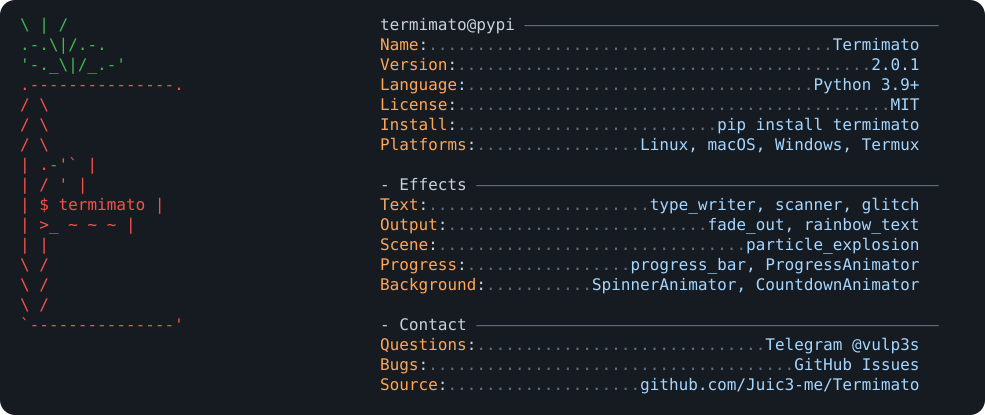

<div align="center">
  <picture>
    <source media="(prefers-color-scheme: dark)" srcset="https://raw.githubusercontent.com/Juic3-me/Termimato/main/assets/banner_dark.svg">
    <source media="(prefers-color-scheme: light)" srcset="https://raw.githubusercontent.com/Juic3-me/Termimato/main/assets/banner_light.svg">
    
  </picture>
</div>

<br>

<div align="center">
  <a href="https://github.com/Juic3-me/Termimato/blob/main/README.ru.md"></a>
  &nbsp;&nbsp;
  
</div>

<br>

<p align="center">
  <a href="https://pypi.org/project/termimato"></a>
  
  <a href="https://github.com/Juic3-me/Termimato/actions/workflows/ci.yml"></a>
  <a href="https://github.com/Juic3-me/Termimato/blob/main/LICENSE"></a>
  <a href="https://t.me/vulp3s"></a>
</p>

## About

Termimato is a Python library for text animations in the terminal. Every effect is a coroutine, so animations run next to the rest of an asyncio program and do not block it. The library hides and restores the cursor, cleans up the line after an effect finishes and supports 8-bit and 24-bit colors.

Available effects: typewriter, scanner, glitch, text fade-out, progress bar, rainbow text and particle explosion. Background animators: spinner, progress bar with ETA and countdown.

## Installation

Python 3.9 or newer is required.

```
pip install termimato
```

Check that the installation works:

```
python -c "import termimato; print(termimato.__version__)"
```

### Linux and macOS

If `pip` is missing, install it through the system package manager (`sudo apt install python3-pip` on Debian and Ubuntu). To keep the library out of the global environment, use a virtual environment:

```
python3 -m venv .venv
source .venv/bin/activate
pip install termimato
```

### Windows

Use Windows Terminal or PowerShell. In the command prompt run:

```
py -m pip install termimato
```

ANSI processing in the console is enabled by the library when the context manager starts.

### Termux (Android)

```
pkg update
pkg install python
pip install termimato
```

### From source

```
git clone https://github.com/Juic3-me/Termimato
cd Termimato
pip install .
```

## Quick start

Save the example as `hello.py` and run `python hello.py` in a terminal.

```python
import asyncio

from termimato import Colors, Termimato, type_writer


async def main():
    async with Termimato() as t:
        await t.play(type_writer, "Hello, World!", color=Colors.GREEN)

        spinner = await t.start_spinner("Processing...", color=Colors.CYAN)
        await asyncio.sleep(2)
        spinner.cancel()


if __name__ == "__main__":
    asyncio.run(main())
```

What happens here:

1. `async with Termimato()` checks that the output is a terminal and hides the cursor. On exit, including exit through an exception, it cancels running animations and shows the cursor again.
2. `t.play(effect, ...)` runs an effect and waits until it finishes. Any argument after the effect is passed to it unchanged.
3. `t.start_spinner(...)` starts a spinner in the background and returns an `asyncio.Task`. The spinner runs while your code does other work. `spinner.cancel()` stops it and clears its line.

More runnable scripts are in the [examples](examples) folder. `python examples/showcase.py` plays every effect in turn.

## Effects

Every effect is an `async` function. Call it directly with `await`, or through `Termimato.play`. Parameters marked with a config key take their default value from the [configuration](#configuration).

### type_writer

Prints text one character at a time. Punctuation and line breaks get a longer pause, spaces a shorter one.

| Parameter | Default | Description |
| --- | --- | --- |
| `text` | | Text to print |
| `speed` | `default_speed` | Seconds per character |
| `color` | `Colors.RESET` | ANSI color or a `ColorTheme` |
| `jitter` | `type_writer_jitter` | Random spread of the delay, from 0 to 1 |
| `sound_effect` | `False` | Send a bell character to stderr after each character |
| `on_char` | `None` | Function called with every printed character |

### scanner

A highlighted block moves along the line from left to right.

| Parameter | Default | Description |
| --- | --- | --- |
| `text` | | Text to scan |
| `speed` | `0.08` | Seconds per step |
| `color` | `Colors.GREEN` | Highlight color |
| `width` | `scanner_width` | Width of the highlighted block in characters |
| `bounce` | `False` | Move back after reaching the end |

### glitch

The line is distorted with random characters and shifts sideways, then returns to the original text.

| Parameter | Default | Description |
| --- | --- | --- |
| `text` | | Text to distort |
| `duration` | `2.0` | Effect length in seconds |
| `intensity` | `0.1` | Share of characters replaced per frame, from 0 to 1. Falls by half toward the end |
| `color` | `Colors.RED` | Color of the distorted line |
| `charset` | `glitch_charset` | Characters used for noise |
| `preserve_spaces` | `True` | Keep spaces unchanged |

### fade_out

Makes the line disappear and leaves an empty line behind.

| Parameter | Default | Description |
| --- | --- | --- |
| `text` | | Text to remove |
| `speed` | `0.05` | Seconds per step |
| `effect` | `fade_out_effect` | `dots`, `fade`, `dissolve` or `vaporize` |
| `color` | `Colors.RESET` | Text color. The `fade` effect uses a gray scale and ignores it |

An unknown effect name raises `EffectNotFoundError` before anything is printed.

### progress_bar

Fills a bar from 0 to `total` on its own, one step per `speed` seconds. Use it for demonstrations. For a bar that follows real work, see `ProgressAnimator` below.

| Parameter | Default | Description |
| --- | --- | --- |
| `total` | | Number of steps, must be greater than zero |
| `prefix`, `suffix` | `""` | Text before and after the bar |
| `length` | `30` | Bar width in characters |
| `fill`, `empty` | `█`, `░` | Characters for the filled and empty part |
| `color` | `Colors.GREEN` | Bar color |
| `show_percentage` | `True` | Show percent |
| `show_count` | `True` | Show the `(i/total)` counter |
| `speed` | `0.1` | Seconds per step |

### rainbow_text

Colors travel along the text. With `cycle=True` the effect runs until the task is cancelled; the plain text is restored when it stops.

| Parameter | Default | Description |
| --- | --- | --- |
| `text` | | Text to color |
| `speed` | `0.1` | Seconds per frame |
| `cycle` | `True` | `False` plays exactly 60 frames and stops |

Run an endless rainbow in the background like this:

```python
rainbow = asyncio.create_task(rainbow_text("Loading"))
await asyncio.sleep(3)
rainbow.cancel()
```

### particle_explosion

The characters of the text break into particles that fly apart and fall. The effect draws on the alternate screen, so the previous contents of the terminal come back when it ends.

| Parameter | Default | Description |
| --- | --- | --- |
| `text` | | Text to blow up |
| `duration` | `1.5` | Effect length in seconds |
| `particle_count` | `50` | Approximate number of particles |

## Animators

Animators are classes for long-running output. All of them share the same methods:

| Method | Description |
| --- | --- |
| `await start()` | Run the animation and wait for it to end |
| `await stop()` | Stop it and clean up the line |
| `await pause()`, `await resume()` | Pause and continue |
| `get_stats()` | Dictionary with the state, duration, frame count and FPS |

The `state` attribute holds an `AnimationState`: `IDLE`, `RUNNING`, `PAUSED`, `COMPLETED`, `CANCELLED` or `ERROR`. Starting an animator that is already running raises `AnimationError`.

**SpinnerAnimator**(`frames=None`, `label="Loading"`, `color=Colors.CYAN`, `interval=0.1`). Without `frames` it uses braille characters. On fonts without them pass your own, for example `("|", "/", "-", "\\")`.

**ProgressAnimator**(`total=100`, `label="Progress"`, `color=Colors.CYAN`, `width=40`, `show_percentage=True`, `show_eta=True`). Update it from your code with `update(value)` or `increment(amount=1)`. When the value reaches `total`, `start()` returns. `await complete()` prints the final line with the elapsed time.

```python
bar = ProgressAnimator(total=50, label="Copying")
drawing = asyncio.create_task(bar.start())

for _ in range(50):
    await do_work()
    bar.increment()

await drawing
await bar.complete()
```

**CountdownAnimator**(`seconds=10`, `format_string="{seconds:02d}"`, `color=Colors.BRIGHT_RED`, `final_message="GO!"`). Every number stays on screen for one full second. Placeholders for `format_string`:

| Placeholder | Value |
| --- | --- |
| `{seconds}` | Seconds left in total |
| `{minutes}`, `{hours}` | Minutes (0 to 59) and whole hours left |
| `{formatted_seconds}`, `{formatted_minutes}`, `{formatted_hours}` | Seconds, minutes and hours as two-digit strings |

For a clock use `"{formatted_minutes}:{formatted_seconds}"`.

**TextAnimator**(`text`, `effect_func`, `effect_name="TextEffect"`). Wraps any effect that takes only the text, and gives it the state and metrics of an animator.

## Colors and themes

`Colors` holds ANSI constants (`Colors.RED`, `Colors.BRIGHT_CYAN`, `Colors.BG_BLUE`, `Colors.BOLD`, `Colors.RESET` and others) and helpers:

```python
Colors.rgb(255, 120, 0)      # text color, 24-bit
Colors.bg_rgb(20, 20, 20)    # background color, 24-bit
Colors.gradient("Termimato", (255, 0, 0), (0, 0, 255))
```

If the terminal has no true color, set `enable_true_color=False` in the configuration. `rgb`, `bg_rgb` and `gradient` then produce 8-bit codes. With `fallback_to_8bit=False` as well, they raise `ColorNotSupportedError`.

`ColorTheme` is a set of named colors (`primary`, `secondary`, `accent`, `error`, `success`, `warning`, `info`). Ready-made themes: `ColorTheme.dark()`, `ColorTheme.light()`, `ColorTheme.rainbow()`. You can build your own: `ColorTheme(primary=Colors.rgb(255, 120, 0))`. An effect that receives a theme as `color` uses its `primary` color. `Termimato(theme="light")` or `Termimato(theme=my_theme)` sets the theme of the session, available as `t.theme`.

## Configuration

Settings live in `TermimatoConfig`. Change them in code:

```python
from termimato import update_config

update_config(default_speed=0.03, scanner_width=5)
```

or keep them in `~/.config/termimato/config.json`. The file is read on first use. `save_config()` writes the current settings there, `load_config(path)` reads any other file, `reset_config()` returns the defaults.

| Option | Default | Description |
| --- | --- | --- |
| `auto_restore_cursor` | `True` | Hide the cursor inside `Termimato` and show it on exit |
| `check_terminal_support` | `True` | Raise `TerminalError` if output is not a terminal |
| `default_speed` | `0.05` | Default `speed` of `type_writer` |
| `max_concurrent_animations` | `10` | Limit of background animations in one `Termimato` |
| `enable_true_color` | `True` | Use 24-bit colors |
| `fallback_to_8bit` | `True` | Use 8-bit colors when true color is off |
| `default_theme` | `"dark"` | Theme of a session: `dark`, `light` or `rainbow` |
| `type_writer_jitter` | `0.5` | Default `jitter` of `type_writer` |
| `scanner_width` | `3` | Default `width` of `scanner` |
| `glitch_charset` | `X#&%$@*!?<>/\` | Default `charset` of `glitch` |
| `fade_out_effect` | `"dots"` | Default `effect` of `fade_out` |

Unknown keys in the file are ignored, so a config written by an older version still loads.

## Errors

All library exceptions inherit from `TermimatoError`.

| Exception | When |
| --- | --- |
| `TerminalError` | Output is not a terminal and `check_terminal_support` is on |
| `AnimationError` | An effect failed inside `play`, an animator failed, an animator is started twice, or the concurrency limit is reached |
| `EffectNotFoundError` | Unknown `effect` in `fade_out` |
| `ConfigurationError` | Unknown option, broken config file, unknown theme name |
| `ColorNotSupportedError` | 24-bit colors are off and the 8-bit fallback is off too |

`Termimato.play` wraps an exception raised by an effect into `AnimationError`. The original exception stays available as `__cause__` and the effect name as `effect_name`.

## Compatibility

| Platform | Terminals |
| --- | --- |
| Linux | GNOME Terminal, Konsole, xterm and others |
| macOS | iTerm2, Terminal.app |
| Windows | Windows Terminal, PowerShell |
| Android | Termux |

Tests run in CI on Linux, macOS and Windows with Python 3.9 to 3.13.

## Troubleshooting

**`TerminalError: stdout is not a terminal`.** The program runs with redirected output or inside an IDE console. Run it in a real terminal, or turn the check off: `update_config(check_terminal_support=False)`.

**The cursor stays hidden after the program was killed.** Run `tput cnorm` or `printf '\033[?25h'`. After a normal exit and after `Ctrl+C` the library restores the cursor itself.

**The spinner shows empty squares.** The font has no braille characters. Pass other frames: `t.start_spinner("Wait", frames=("|", "/", "-", "\\"))`.

**Colors look wrong.** Set `enable_true_color=False` to use 8-bit colors.

**`ModuleNotFoundError: No module named 'termimato'`.** The package is installed for another Python. Install it with the same interpreter that runs the script: `python -m pip install termimato`.

## Questions and support

| Reason | Where |
| --- | --- |
| Usage questions and ideas | [Discussions](https://github.com/Juic3-me/Termimato/discussions) |
| Bug or crash | [Issues](https://github.com/Juic3-me/Termimato/issues/new/choose) |
| Security problem | See [SECURITY.md](https://github.com/Juic3-me/Termimato/blob/main/SECURITY.md) |
| Direct contact with the author | [Telegram @vulp3s](https://t.me/vulp3s) |

Before opening an issue, check that the problem is reproducible on the latest version and include the details requested in the template.

## Contributing

Pull requests are welcome. Read [CONTRIBUTING.md](https://github.com/Juic3-me/Termimato/blob/main/CONTRIBUTING.md) first: it describes how to set up the project, run the tests and prepare a change. Participation is governed by the [code of conduct](https://github.com/Juic3-me/Termimato/blob/main/CODE_OF_CONDUCT.md). The list of changes is in [CHANGELOG.md](https://github.com/Juic3-me/Termimato/blob/main/CHANGELOG.md).

## License

Released under the MIT License. See [LICENSE](https://github.com/Juic3-me/Termimato/blob/main/LICENSE).
