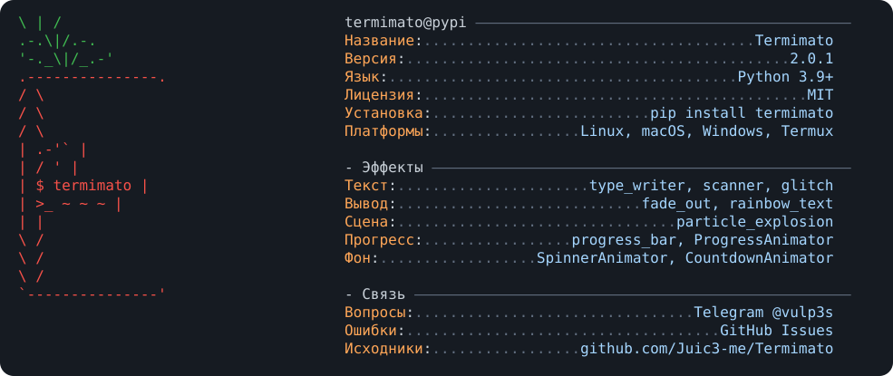

<div align="center">
  <picture>
    <source media="(prefers-color-scheme: dark)" srcset="https://raw.githubusercontent.com/Juic3-me/Termimato/main/assets/banner_dark_ru.svg">
    <source media="(prefers-color-scheme: light)" srcset="https://raw.githubusercontent.com/Juic3-me/Termimato/main/assets/banner_light_ru.svg">
    
  </picture>
</div>

<br>

<div align="center">
  
  &nbsp;&nbsp;
  <a href="https://github.com/Juic3-me/Termimato/blob/main/README.md"></a>
</div>

<br>

<p align="center">
  <a href="https://pypi.org/project/termimato"></a>
  
  <a href="https://github.com/Juic3-me/Termimato/actions/workflows/ci.yml"></a>
  <a href="https://github.com/Juic3-me/Termimato/blob/main/LICENSE"></a>
  <a href="https://t.me/vulp3s"></a>
</p>

## О проекте

Termimato это библиотека Python для текстовых анимаций в терминале. Каждый эффект является корутиной, поэтому анимации работают рядом с остальной программой на asyncio и не блокируют её. Библиотека прячет и возвращает курсор, очищает строку после завершения эффекта и поддерживает 8-битные и 24-битные цвета.

Эффекты: печатная машинка, сканер, глитч, исчезновение текста, прогресс-бар, радужный текст и взрыв на частицы. Фоновые аниматоры: спиннер, прогресс-бар с ETA и обратный отсчёт.

## Установка

Нужен Python 3.9 или новее.

```
pip install termimato
```

Проверка установки:

```
python -c "import termimato; print(termimato.__version__)"
```

### Linux и macOS

Если `pip` не установлен, поставьте его через менеджер пакетов (`sudo apt install python3-pip` в Debian и Ubuntu). Чтобы не засорять глобальное окружение, используйте виртуальное:

```
python3 -m venv .venv
source .venv/bin/activate
pip install termimato
```

### Windows

Используйте Windows Terminal или PowerShell. В командной строке:

```
py -m pip install termimato
```

Обработку ANSI-последовательностей в консоли библиотека включает сама при входе в контекстный менеджер.

### Termux (Android)

```
pkg update
pkg install python
pip install termimato
```

### Из исходников

```
git clone https://github.com/Juic3-me/Termimato
cd Termimato
pip install .
```

## Быстрый старт

Сохраните пример как `hello.py` и запустите `python hello.py` в терминале.

```python
import asyncio

from termimato import Colors, Termimato, type_writer


async def main():
    async with Termimato() as t:
        await t.play(type_writer, "Hello, World!", color=Colors.GREEN)

        spinner = await t.start_spinner("Processing...", color=Colors.CYAN)
        await asyncio.sleep(2)
        spinner.cancel()


if __name__ == "__main__":
    asyncio.run(main())
```

Что здесь происходит:

1. `async with Termimato()` проверяет, что вывод идёт в терминал, и прячет курсор. При выходе, в том числе из-за исключения, он отменяет работающие анимации и возвращает курсор.
2. `t.play(effect, ...)` запускает эффект и ждёт его завершения. Все аргументы после эффекта передаются ему без изменений.
3. `t.start_spinner(...)` запускает спиннер в фоне и возвращает `asyncio.Task`. Спиннер крутится, пока ваш код занят другой работой. `spinner.cancel()` останавливает его и очищает строку.

Больше готовых скриптов в папке [examples](examples). Команда `python examples/showcase.py` по очереди показывает все эффекты.

## Эффекты

Каждый эффект это `async`-функция. Вызывайте её через `await` напрямую или через `Termimato.play`. Параметры со значением в виде ключа конфигурации берут умолчание из [конфигурации](#конфигурация).

### type_writer

Печатает текст по одному символу. После знаков препинания и переводов строки пауза длиннее, после пробела короче.

| Параметр | Умолчание | Описание |
| --- | --- | --- |
| `text` | | Текст для печати |
| `speed` | `default_speed` | Секунд на символ |
| `color` | `Colors.RESET` | ANSI-цвет или `ColorTheme` |
| `jitter` | `type_writer_jitter` | Случайный разброс задержки, от 0 до 1 |
| `sound_effect` | `False` | Отправлять символ звонка в stderr после каждого символа |
| `on_char` | `None` | Функция, которая вызывается с каждым напечатанным символом |

### scanner

Подсвеченный блок движется по строке слева направо.

| Параметр | Умолчание | Описание |
| --- | --- | --- |
| `text` | | Текст для сканирования |
| `speed` | `0.08` | Секунд на шаг |
| `color` | `Colors.GREEN` | Цвет подсветки |
| `width` | `scanner_width` | Ширина подсвеченного блока в символах |
| `bounce` | `False` | После конца двигаться обратно |

### glitch

Строка искажается случайными символами и смещается в стороны, затем возвращается к исходному тексту.

| Параметр | Умолчание | Описание |
| --- | --- | --- |
| `text` | | Текст для искажения |
| `duration` | `2.0` | Длительность эффекта в секундах |
| `intensity` | `0.1` | Доля символов, заменяемых за кадр, от 0 до 1. К концу снижается вдвое |
| `color` | `Colors.RED` | Цвет искажённой строки |
| `charset` | `glitch_charset` | Символы для помех |
| `preserve_spaces` | `True` | Не трогать пробелы |

### fade_out

Убирает строку и оставляет после себя пустую.

| Параметр | Умолчание | Описание |
| --- | --- | --- |
| `text` | | Текст, который нужно убрать |
| `speed` | `0.05` | Секунд на шаг |
| `effect` | `fade_out_effect` | `dots`, `fade`, `dissolve` или `vaporize` |
| `color` | `Colors.RESET` | Цвет текста. Эффект `fade` использует серую шкалу и его игнорирует |

Неизвестное имя эффекта вызывает `EffectNotFoundError` до того, как что-либо напечатано.

### progress_bar

Сам заполняет полосу от 0 до `total`, один шаг за `speed` секунд. Подходит для демонстраций. Для полосы, которая следует за реальной работой, используйте `ProgressAnimator` ниже.

| Параметр | Умолчание | Описание |
| --- | --- | --- |
| `total` | | Число шагов, больше нуля |
| `prefix`, `suffix` | `""` | Текст до и после полосы |
| `length` | `30` | Ширина полосы в символах |
| `fill`, `empty` | `█`, `░` | Символы заполненной и пустой части |
| `color` | `Colors.GREEN` | Цвет полосы |
| `show_percentage` | `True` | Показывать проценты |
| `show_count` | `True` | Показывать счётчик `(i/total)` |
| `speed` | `0.1` | Секунд на шаг |

### rainbow_text

Цвета бегут по тексту. При `cycle=True` эффект работает, пока задачу не отменят; после остановки текст возвращается к обычному виду.

| Параметр | Умолчание | Описание |
| --- | --- | --- |
| `text` | | Текст для раскраски |
| `speed` | `0.1` | Секунд на кадр |
| `cycle` | `True` | `False` проигрывает ровно 60 кадров и останавливается |

Бесконечную радугу в фоне запускают так:

```python
rainbow = asyncio.create_task(rainbow_text("Loading"))
await asyncio.sleep(3)
rainbow.cancel()
```

### particle_explosion

Символы текста разлетаются частицами и падают. Эффект рисуется на альтернативном экране, поэтому после его окончания прежнее содержимое терминала возвращается.

| Параметр | Умолчание | Описание |
| --- | --- | --- |
| `text` | | Текст для взрыва |
| `duration` | `1.5` | Длительность эффекта в секундах |
| `particle_count` | `50` | Примерное число частиц |

## Аниматоры

Аниматоры это классы для долгого вывода. У всех одинаковые методы:

| Метод | Описание |
| --- | --- |
| `await start()` | Запустить анимацию и дождаться её конца |
| `await stop()` | Остановить и очистить строку |
| `await pause()`, `await resume()` | Пауза и продолжение |
| `get_stats()` | Словарь с состоянием, длительностью, числом кадров и FPS |

В атрибуте `state` лежит `AnimationState`: `IDLE`, `RUNNING`, `PAUSED`, `COMPLETED`, `CANCELLED` или `ERROR`. Повторный запуск уже работающего аниматора вызывает `AnimationError`.

**SpinnerAnimator**(`frames=None`, `label="Loading"`, `color=Colors.CYAN`, `interval=0.1`). Без `frames` использует символы Брайля. Если шрифт их не поддерживает, передайте свои, например `("|", "/", "-", "\\")`.

**ProgressAnimator**(`total=100`, `label="Progress"`, `color=Colors.CYAN`, `width=40`, `show_percentage=True`, `show_eta=True`). Обновляйте его из своего кода через `update(value)` или `increment(amount=1)`. Когда значение достигает `total`, `start()` завершается. `await complete()` печатает итоговую строку с затраченным временем.

```python
bar = ProgressAnimator(total=50, label="Copying")
drawing = asyncio.create_task(bar.start())

for _ in range(50):
    await do_work()
    bar.increment()

await drawing
await bar.complete()
```

**CountdownAnimator**(`seconds=10`, `format_string="{seconds:02d}"`, `color=Colors.BRIGHT_RED`, `final_message="GO!"`). Каждое число остаётся на экране целую секунду. Подстановки для `format_string`:

| Подстановка | Значение |
| --- | --- |
| `{seconds}` | Сколько секунд осталось всего |
| `{minutes}`, `{hours}` | Минуты (от 0 до 59) и целые часы, которые осталось ждать |
| `{formatted_seconds}`, `{formatted_minutes}`, `{formatted_hours}` | Секунды, минуты и часы в виде двузначных строк |

Для часов используйте `"{formatted_minutes}:{formatted_seconds}"`.

**TextAnimator**(`text`, `effect_func`, `effect_name="TextEffect"`). Оборачивает любой эффект, принимающий только текст, и даёт ему состояние и метрики аниматора.

## Цвета и темы

В `Colors` лежат ANSI-константы (`Colors.RED`, `Colors.BRIGHT_CYAN`, `Colors.BG_BLUE`, `Colors.BOLD`, `Colors.RESET` и другие) и вспомогательные методы:

```python
Colors.rgb(255, 120, 0)      # цвет текста, 24 бита
Colors.bg_rgb(20, 20, 20)    # цвет фона, 24 бита
Colors.gradient("Termimato", (255, 0, 0), (0, 0, 255))
```

Если терминал не поддерживает true color, задайте в конфигурации `enable_true_color=False`. Тогда `rgb`, `bg_rgb` и `gradient` будут выдавать 8-битные коды. Если дополнительно отключить `fallback_to_8bit`, они вызовут `ColorNotSupportedError`.

`ColorTheme` это набор именованных цветов (`primary`, `secondary`, `accent`, `error`, `success`, `warning`, `info`). Готовые темы: `ColorTheme.dark()`, `ColorTheme.light()`, `ColorTheme.rainbow()`. Свою тему можно создать так: `ColorTheme(primary=Colors.rgb(255, 120, 0))`. Эффект, получивший тему в параметре `color`, берёт её цвет `primary`. `Termimato(theme="light")` или `Termimato(theme=my_theme)` задаёт тему сессии, она доступна как `t.theme`.

## Конфигурация

Настройки хранятся в `TermimatoConfig`. Меняйте их из кода:

```python
from termimato import update_config

update_config(default_speed=0.03, scanner_width=5)
```

или храните в файле `~/.config/termimato/config.json`. Файл читается при первом обращении. `save_config()` записывает туда текущие настройки, `load_config(path)` читает любой другой файл, `reset_config()` возвращает значения по умолчанию.

| Параметр | Умолчание | Описание |
| --- | --- | --- |
| `auto_restore_cursor` | `True` | Прятать курсор внутри `Termimato` и возвращать при выходе |
| `check_terminal_support` | `True` | Вызывать `TerminalError`, если вывод идёт не в терминал |
| `default_speed` | `0.05` | Значение `speed` по умолчанию у `type_writer` |
| `max_concurrent_animations` | `10` | Предел фоновых анимаций в одном `Termimato` |
| `enable_true_color` | `True` | Использовать 24-битные цвета |
| `fallback_to_8bit` | `True` | Использовать 8-битные цвета, когда true color выключен |
| `default_theme` | `"dark"` | Тема сессии: `dark`, `light` или `rainbow` |
| `type_writer_jitter` | `0.5` | Значение `jitter` по умолчанию у `type_writer` |
| `scanner_width` | `3` | Значение `width` по умолчанию у `scanner` |
| `glitch_charset` | `X#&%$@*!?<>/\` | Значение `charset` по умолчанию у `glitch` |
| `fade_out_effect` | `"dots"` | Значение `effect` по умолчанию у `fade_out` |

Неизвестные ключи в файле игнорируются, поэтому конфигурация, записанная старой версией, продолжает загружаться.

## Ошибки

Все исключения библиотеки наследуются от `TermimatoError`.

| Исключение | Когда возникает |
| --- | --- |
| `TerminalError` | Вывод идёт не в терминал, а `check_terminal_support` включён |
| `AnimationError` | Эффект упал внутри `play`, аниматор завершился ошибкой, аниматор запущен дважды или достигнут предел одновременных анимаций |
| `EffectNotFoundError` | Неизвестный `effect` в `fade_out` |
| `ConfigurationError` | Неизвестный параметр, повреждённый файл конфигурации, неизвестное имя темы |
| `ColorNotSupportedError` | 24-битные цвета выключены и 8-битная замена тоже выключена |

`Termimato.play` оборачивает исключение эффекта в `AnimationError`. Исходное исключение доступно как `__cause__`, а имя эффекта как `effect_name`.

## Совместимость

| Платформа | Терминалы |
| --- | --- |
| Linux | GNOME Terminal, Konsole, xterm и другие |
| macOS | iTerm2, Terminal.app |
| Windows | Windows Terminal, PowerShell |
| Android | Termux |

Тесты запускаются в CI на Linux, macOS и Windows с Python 3.9 до 3.13.

## Частые проблемы

**`TerminalError: stdout is not a terminal`.** Программа запущена с перенаправленным выводом или в консоли IDE. Запустите её в настоящем терминале или отключите проверку: `update_config(check_terminal_support=False)`.

**После принудительного завершения программы курсор остался скрытым.** Выполните `tput cnorm` или `printf '\033[?25h'`. После обычного завершения и после `Ctrl+C` библиотека возвращает курсор сама.

**Вместо спиннера пустые квадраты.** В шрифте нет символов Брайля. Передайте другие кадры: `t.start_spinner("Wait", frames=("|", "/", "-", "\\"))`.

**Цвета выглядят неправильно.** Установите `enable_true_color=False`, чтобы использовать 8-битные цвета.

**`ModuleNotFoundError: No module named 'termimato'`.** Пакет установлен для другого Python. Устанавливайте тем же интерпретатором, которым запускаете скрипт: `python -m pip install termimato`.

## Вопросы и поддержка

| Повод | Куда писать |
| --- | --- |
| Вопросы по использованию и идеи | [Discussions](https://github.com/Juic3-me/Termimato/discussions) |
| Ошибка или падение | [Issues](https://github.com/Juic3-me/Termimato/issues/new/choose) |
| Проблема безопасности | См. [SECURITY.md](https://github.com/Juic3-me/Termimato/blob/main/SECURITY.md) |
| Связь с автором напрямую | [Telegram @vulp3s](https://t.me/vulp3s) |

Перед созданием issue проверьте, что проблема воспроизводится на последней версии, и приложите данные, которые просит шаблон.

## Участие в разработке

Пул-реквесты приветствуются. Сначала прочитайте [CONTRIBUTING.md](https://github.com/Juic3-me/Termimato/blob/main/CONTRIBUTING.md): там описано, как подготовить проект, запустить тесты и оформить изменение. Участие регулируется [кодексом поведения](https://github.com/Juic3-me/Termimato/blob/main/CODE_OF_CONDUCT.md). Список изменений ведётся в [CHANGELOG.md](https://github.com/Juic3-me/Termimato/blob/main/CHANGELOG.md).

## Лицензия

Проект распространяется по лицензии MIT. См. [LICENSE](https://github.com/Juic3-me/Termimato/blob/main/LICENSE).
